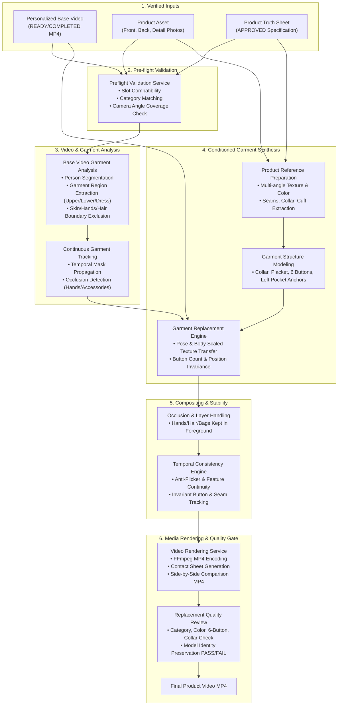

# Garment Replacement Engine Architecture

## 1. System Overview & Mandate

The **Garment Replacement Engine** is the core commercial transformation system of **TrendMotion Studio**. It replaces the clothing worn by the human subject in a **Personalized Base Video** with the real fashion garment defined by a **Product Asset** and its verified **Product Truth Sheet**.

### Strict Non-Cloud Architecture Principle
- **100% Backend-Owned & Executed Locally**: All video frame decoding, garment region analysis, mask tracking, feature synthesis, occlusion layer management, temporal smoothing, and media rendering are executed on the local server.
- **Zero External AI Cloud APIs**: Absolutely no video frames, model assets, product photos, or Truth Sheet specifications are transmitted to external services (such as OpenAI, Gemini, Runway, Kling, Replicate, fal.ai, or hosted cloud inference).
- **Local Model Execution**: Local models and computer vision pipelines run on local CPU/CUDA GPU hardware via PyTorch, ONNX Runtime, OpenCV, and FFmpeg, managed by the local `ModelRuntimeManager` under `data/models/`.
- **Local Filesystem Isolation**:
  `data/storage/users/{user_id}/projects/{project_id}/replacements/{replacement_job_id}/`

---

## 2. Pipeline Stages & Architectural Data Flow



---

## 3. Modular Responsibilities (`apps/api/app/services/garment_engine/`)

| Module | Architectural Responsibility |
|---|---|
| `preflight.py` | Validates prerequisites: Base Video integrity, Product Asset existence, Truth Sheet approval, garment slot compatibility (e.g. `upper_body`), camera angle coverage. |
| `garment_analysis.py` | Segments the existing clothing in each frame of the Personalized Base Video while protecting face, neck, arms, hands, legs, and background. |
| `garment_tracking.py` | Maintains continuous temporal tracking of garment masks across all frames, tracking ID stability and identifying occlusions. |
| `product_reference.py` | Preprocesses product photos (front, back, collar, fabric texture) and compiles structured constraints from the Truth Sheet. |
| `garment_structure.py` | Defines spatial anchors for garment components: collar points, front placket, exact button counts (e.g. 6 buttons), pocket coordinates, cuff buttons. |
| `replacement_engine.py` | Synthesizes the new garment onto the model body frame by frame conditioned on driving motion and Truth Sheet constraints. |
| `occlusion_handling.py` | Enforces foreground layer ordering so that hands crossing the torso, hair over shoulders, and accessories remain in front of the new clothing. |
| `temporal_consistency.py` | Applies temporal smoothing across consecutive frames ($\alpha = 0.88$) to eliminate texture swimming, color jitter, and button flickering. |
| `quality_review.py` | Performs automated quality inspection across 10 criteria: category, color shade, 6 buttons, left pocket, collar, cuffs, seams, model identity, occlusion, video compliance. |
| `rendering.py` | Encodes final MP4 with source audio pass-through, generates representative 8-frame Contact Sheet, and produces side-by-side comparison video. |
| `pipeline.py` | Master orchestrator managing asynchronous state machine transitions, error recovery, and VRAM memory lifecycle. |

---

## 4. Product Truth Sheet Constraint Schema

The engine reads structural constraints directly from the approved Product Truth Sheet:

```json
{
  "category": "shirt",
  "silhouette": "regular_fit",
  "primary_color": "#FFFFFF",
  "neckline_collar": {
    "type": "pointed_collar",
    "collar_spread": "medium"
  },
  "buttons": {
    "count": 6,
    "color": "#FFFFFF",
    "shape": "round",
    "placement": "front_placket_vertical"
  },
  "pockets": {
    "count": 1,
    "placement": "left_chest",
    "type": "patch_pocket"
  },
  "sleeves": {
    "type": "long_sleeve",
    "cuff_type": "buttoned",
    "cuff_button_count": 2
  },
  "fabric_appearance": "matte_cotton",
  "pattern": "solid"
}
```

---

## 5. State Machine & Job Lifecycle

A `ProductReplacementJob` progresses through explicit stages:
1. `PENDING`: Initial registration.
2. `VALIDATING_INPUTS`: Verifying Base Video, Product Asset, and Truth Sheet.
3. `ANALYZING_BASE_VIDEO`: Decoding frames and isolating subject clothing.
4. `TRACKING_GARMENT`: Generating temporal masks with occlusion detection.
5. `PREPARING_PRODUCT`: Extracting textures, collar, cuffs, and button reference crops.
6. `BUILDING_CONSTRAINTS`: Establishing spatial anchors for 6 buttons, pocket, and collar.
7. `GENERATING_FRAMES`: Synthesizing identity-preserved garment frames.
8. `COMPOSITING`: Layering foreground occlusions (hands, hair, accessories).
9. `TEMPORAL_CHECK`: Applying multi-frame smoothing and button invariance check.
10. `RENDERING`: Assembling H.264 MP4, contact sheet, and comparison video.
11. `QUALITY_REVIEW`: Evaluating automated quality gate.
12. `COMPLETED` / `NEEDS_REVIEW`: Ready for user inspection and final approval.
