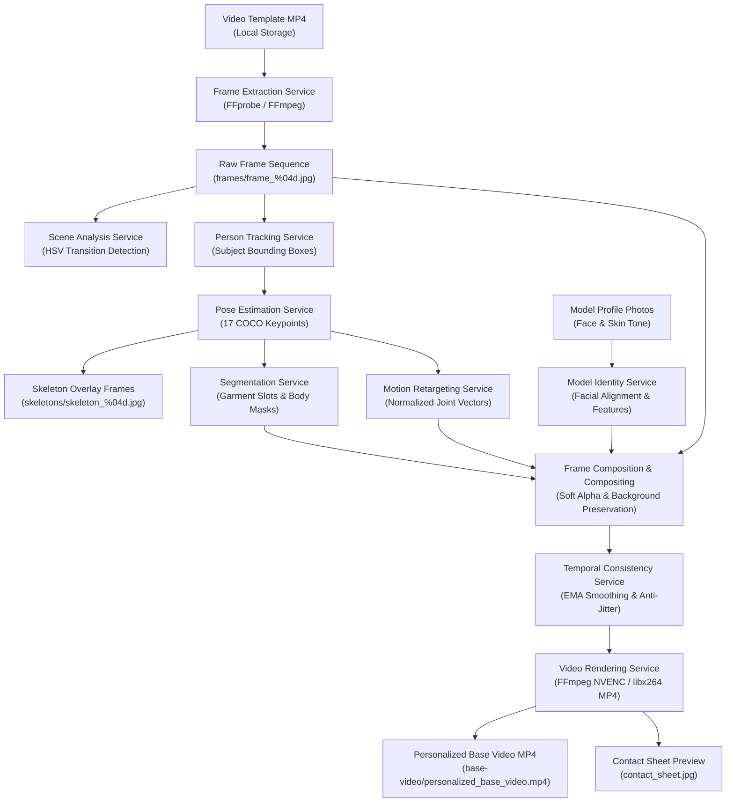

# Local Backend Video Analysis & Model Personalization Engine Architecture

## 1. System Overview & Mandate

The **TrendMotion Studio Video Engine** is a 100% backend-owned, self-contained processing pipeline executing on the local server infrastructure. It performs full-lifecycle video ingestion, spatial-temporal analysis, human body pose estimation, person tracking, segmentation, motion retargeting, model identity conditioning, frame synthesis, temporal smoothing, media rendering, and quality verification.

### Strict Non-Cloud Architecture Principle
- **Zero External AI Cloud APIs**: Absolutely no media files (video templates, frames, model photos, pose keypoints, masks) are transmitted to third-party AI APIs (such as OpenAI, Gemini, Runway, Kling, Replicate, fal.ai, or Cloudinary).
- **Local Model Execution**: All neural models and computer vision algorithms run on local hardware (PyTorch, ONNX Runtime, OpenCV, FFmpeg) using local CPU and CUDA GPU acceleration.
- **Local Storage Integrity**: All input, intermediate, and output media assets are strictly stored within the project's local filesystem (`data/storage/` and `data/models/`).

---

## 2. Pipeline Architecture & Modular Boundaries

The engine is organized under `apps/api/app/services/video_engine/` with distinct separation of concerns:

```
apps/api/app/services/video_engine/
├── model_runtime.py          # Model Runtime Manager (device, VRAM, weights, checksums)
├── frame_extraction.py       # FFmpeg/FFprobe ingestion & frame decoding
├── scene_analysis.py         # HSV Histogram & camera framing/transition detection
├── person_tracking.py        # Human detection & temporal identity tracking
├── pose_estimation.py        # 17 COCO Keypoints & skeleton frame generation
├── segmentation.py           # Human hull & garment slot segmentation
├── motion_data.py            # Motion representation & intermediate artifact storage
├── motion_retargeting.py     # Normalized skeletal retargeting & angle preserving
├── model_identity.py         # Model photo facial & skin tone extraction
├── frame_composition.py      # Identity-conditioned frame synthesis
├── compositing.py            # Layered background preservation & seam blending
├── temporal_consistency.py   # EMA anti-flicker & jitter elimination
├── rendering.py              # FFmpeg MP4 encoding, audio remux & contact sheet
├── types.py                  # Strongly typed dataclasses for the engine
└── pipeline.py               # Master VideoEngine orchestrator
```

### Data Flow Diagram



---

## 3. Detailed Component Specifications

### 3.1 Model Runtime Manager (`model_runtime.py`)
- **Directory**: `data/models/`
- **Device Management**: Dynamically probes system hardware (NVIDIA CUDA GPU with GTX 1650 4GB VRAM fallback to multi-threaded CPU).
- **VRAM Safety**: Implements explicit memory flushing via `torch.cuda.empty_cache()` and garbage collection between execution stages to prevent OOM errors.
- **Model Registry**: Validates model file integrity, version signatures, and SHA-256 checksums before loading checkpoints into memory.

### 3.2 Person Detection & Continuous Tracking (`person_tracking.py`)
- Tracks the primary human subject across the entire sequence.
- Computes bounding boxes `[x, y, w, h]`, detection confidence, visibility states, and inter-frame IoU/centroid continuity.
- Identifies occlusion windows where the model temporarily leaves the frame or is obstructed, preventing false pose interpolation.

### 3.3 Pose Estimation & Skeleton Extraction (`pose_estimation.py`)
- Extracts 17 COCO body keypoints:
  `nose`, `left/right eye`, `left/right ear`, `left/right shoulder`, `left/right elbow`, `left/right wrist`, `left/right hip`, `left/right knee`, `left/right ankle`.
- Keypoint attributes: `(x, y)` coordinate normalized to frame dimensions, `confidence` score $[0.0, 1.0]$, and `visibility` flag.
- Generates rendered visual skeleton overlay frames (`skeletons/skeleton_%04d.jpg`) for user verification.

### 3.4 Motion Representation & Retargeting (`motion_retargeting.py`)
- Normalizes keypoints relative to torso height and hip center to establish a subject-independent motion representation.
- Calculates joint articulation angles (elbows, knees, hips, shoulders) and body inclination vectors.
- Retargets motion onto the physical proportions of the chosen Model Profile, ensuring limbs are not distorted or artificially stretched.

### 3.5 Human Segmentation & Garment Slots (`segmentation.py`)
- Computes spatial masks for the body hull and identifies candidate garment regions:
  - `upper_body`: Shoulders to hip level.
  - `lower_body`: Hip to ankles.
  - `dress_full_body`: Shoulders to knees/ankles.
- Preserves garment slot visibility and occlusion flags for subsequent fashion workflow stages.

### 3.6 Background Preservation & Layered Compositing (`compositing.py`)
- Distinguishes background context from the human subject.
- Applies edge-feathering Gaussian alpha blending and pose-scaled anchoring so the personalized subject integrates seamlessly with the original scene lighting and geometry.
- Preserves original video background elements and camera framing.

### 3.7 Temporal Consistency & Video Rendering (`temporal_consistency.py`, `rendering.py`)
- Applies exponential moving average (EMA) smoothing across adjacent synthesized frames ($\alpha = 0.85$) to eliminate frame-to-frame flicker and edge jitter.
- FFmpeg encodes the smoothed sequence into a high-quality 9:16 portrait MP4 container with H.264 video codec and AAC source audio pass-through.
- Generates a multi-frame **Contact Sheet** (`contact_sheet.jpg`) sampling key temporal markers (start, movement transition, turnaround, end).

---

## 4. Hardware Sizing & Optimization Matrix

| Hardware Spec | Configuration Mode | Batch Size | Frame Rate Limit | Typical 3s Processing Time |
|---|---|---|---|---|
| **NVIDIA GTX 1650 (4GB VRAM)** | CUDA Mode (FP16 / Mixed) | 4 frames | 15–30 fps | ~4–8 seconds |
| **Intel / AMD CPU (16GB RAM)** | Multi-threaded CPU Mode | 2 frames | 15 fps | ~6–12 seconds |
| **Edge / Minimal CPU** | Quantized ONNX Runtime | 1 frame | 10–15 fps | ~12–18 seconds |
