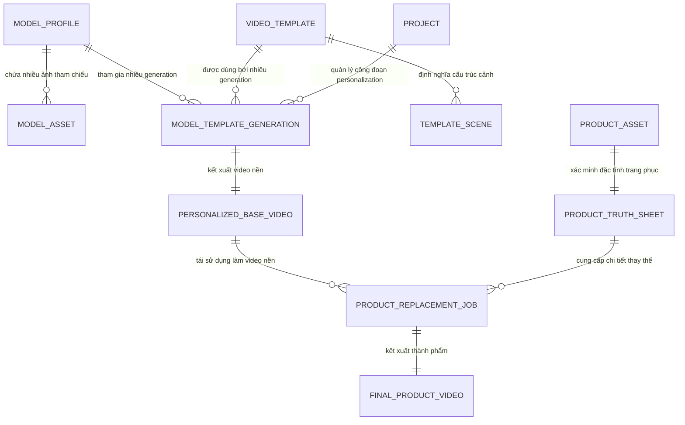
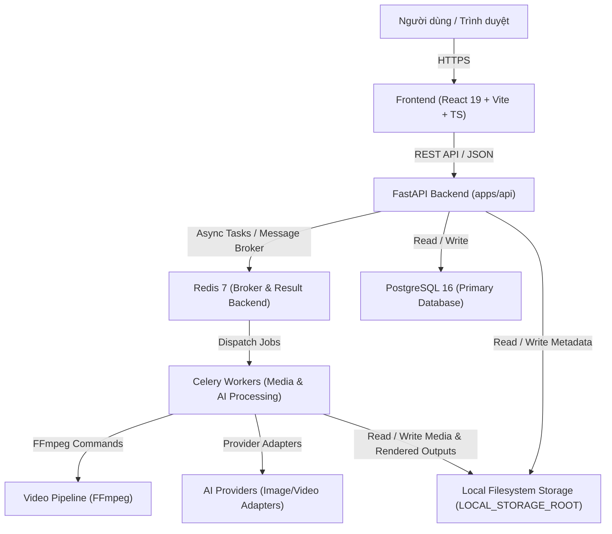

# Tổng Quan Kiến Trúc Hệ Thống TrendMotion Studio

## 1. Giới thiệu tổng quan

TrendMotion Studio là nền tảng SaaS chuyên sâu hỗ trợ người làm nội dung, affiliate marketer và nhà bán lẻ thời trang (Fashion Commerce / TikTok Shop) theo quy trình tái sử dụng tài nguyên tối ưu:
- **Nghiên cứu thị trường & sản phẩm (Product Research):** Khảo sát sản phẩm thời trang thịnh hành, phân tích hiệu suất và cơ hội tiếp thị liên kết.
- **Phân tích kênh & nội dung (Channel & Content Analysis):** Quan sát xu hướng video, phân tích cấu trúc kịch bản và tín hiệu tương tác trên các nền tảng thương mại video.
- **Sản xuất video thời trang theo quy trình 2 công đoạn (AI Fashion Studio):** Không gian làm việc chuyên biệt (Fashion Commerce Workbench) kết hợp tài nguyên độc lập:
  - **Công đoạn 1 (Model Personalization):** Kết hợp hồ sơ người mẫu do người dùng cung cấp ảnh thật (`Model Profile`) vào khung mẫu chuyển động (`Video Template`) để tạo video nền cá nhân hóa (`Personalized Base Video`).
  - **Công đoạn 2 (Garment Replacement):** Thu thập và xác minh dữ liệu sản phẩm từ link thành `Product Truth Sheet`, thay thế chính xác trang phục trong video nền để tạo video thành phẩm (`Final Product Video`).

---

## 2. Quy trình Nghiệp vụ Chuẩn

Hệ thống vận hành theo chuỗi tuần tự nghiêm ngặt, bảo toàn tính bất biến của dữ liệu gốc:

```text
Model Profile ────────┐
                      ├─► Model Personalization ─► Personalized Base Video ─┐
Video Template ───────┘                                                     │
                                                                            ▼
Product Link ─► Asset Extraction ─► Product Truth Sheet ────────► Garment Replacement
                                                                            │
                                                                            ▼
Final Product Video ◄── Quality Review ◄── Temporal Consistency Check ──────┘
```

---

## 3. Quan hệ Nghiệp vụ Nhiều - Nhiều (Many-to-Many)



- **Tính độc lập:** `Model Profile` và `Video Template` là 2 thực thể độc lập tuyệt đối. Không lưu khóa ngoại cố định `templateId` trong Model Profile và ngược lại.
- **Quan hệ Many-to-Many:** Một người mẫu có thể kết hợp với nhiều video mẫu khác nhau; một video mẫu có thể kết hợp với nhiều người mẫu khác nhau.
- **Snapshot Versioning:** Mỗi lần kết hợp tạo một bản ghi `ModelTemplateGeneration` lưu snapshot `modelId`, `modelVersion`, `templateId`, `templateVersion`, giữ cho video nền lịch sử không bị ảnh hưởng khi model hoặc template gốc cập nhật.

---

## 4. Các thành phần kiến trúc cốt lõi



### 4.1. Frontend (`apps/web`)
- **Công nghệ:** React 19, TypeScript, Vite, React Router v6/v7 compat, Tailwind CSS, Lucide React.
- **Vai trò:** Cung cấp giao diện tương tác mượt mà, trực quan theo mô hình Fashion Commerce Workbench. Frontend điều phối layout, quản lý state và gửi request tới Backend; không tự ý quyết định state chuyển đổi hay truy cập trực tiếp hệ thống file/AI providers.

### 4.2. Backend (`apps/api`)
- **Công nghệ:** Python 3.11+, FastAPI, Pydantic, SQLAlchemy 2.0, Alembic.
- **Vai trò:**
  - Định tuyến API phiên bản hóa (`/api/v1`).
  - Kiểm thực schema chặt chẽ (Pydantic request & response validation).
  - Điều phối nghiệp vụ, phân quyền và kiểm soát số dư tín dụng (Credit Wallet).
  - Tích hợp các bên thứ ba thông qua chuẩn Provider Adapter Pattern, ngăn ngừa vendor lock-in.
  - Phân phát tác vụ nặng (render video, xử lý hình ảnh) sang hệ thống Celery Worker.

### 4.3. PostgreSQL 16 (Cơ sở dữ liệu chính)
- **Vai trò:** Lưu trữ toàn bộ dữ liệu giao dịch, tài khoản, siêu dữ liệu sản phẩm, dự án video, hồ sơ người mẫu, generation metadata, kết quả kiểm duyệt chất lượng và nhật ký số dư credit.
- **Đặc điểm:** Toàn vẹn dữ liệu chuẩn ACID, kiểm soát schema bằng Alembic migration.

### 4.4. Redis 7 (Bộ nhớ tạm & Hàng đợi tác vụ)
- **Vai trò:**
  - Đóng vai trò Message Broker và Result Backend cho Celery.
  - Phân phối lock (distributed locks), hạn chế tần suất gọi (rate-limiting) và caching dữ liệu truy vấn đọc nhiều.

### 4.5. Celery Worker & Xử lý Media
- **Vai trò:** Chạy các tiến trình nền độc lập:
  - Điều phối pipeline Model Personalization và Garment Replacement.
  - Phân tích cảnh, keyframe, mask/garment slot và temporal consistency.
  - Xử lý chuyển đổi định dạng, tối ưu độ phân giải và ghép audio bằng FFmpeg.
  - Cập nhật tiến độ xử lý và thông báo trạng thái hoàn tất cho Backend.

### 4.6. Local Filesystem Storage (`LOCAL_STORAGE_ROOT`)
- **Vai trò:** Theo quy tắc bắt buộc tại `AGENTS.md` (Mục 11.1), TrendMotion Studio sử dụng bộ lưu trữ tệp tin cục bộ (Local Filesystem) thay vì cloud object storage.
- **Đặc điểm:**
  - Cấu hình tập trung bằng biến môi trường `LOCAL_STORAGE_ROOT` (mặc định `./data/storage`).
  - Cơ sở dữ liệu chỉ lưu đường dẫn tương đối (relative path) tính từ root lưu trữ cục bộ.
  - Phân tách theo cấu trúc cây thư mục chuẩn: `users/{user_id}/models/`, `users/{user_id}/projects/`, `templates/{template_id}/`, `temp/{job_id}/`.
