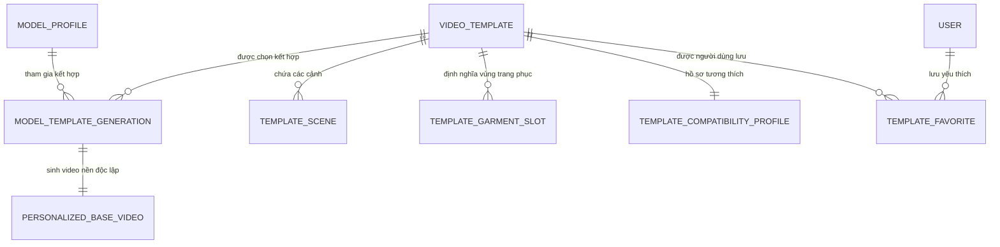

# Mô Hình Dữ Liệu & Thực Thể: Video Template Library

Tài liệu này xác định chi tiết cấu trúc dữ liệu, quan hệ thực thể, các trạng thái đánh giá nghiệp vụ và cấu trúc lưu trữ Local Filesystem cho module Video Template Library trong TrendMotion Studio.

---

## 1. Bản Chất Quan Hệ Many-to-Many



1. **Tính bất biến của Template:** Video Template là tài nguyên mẫu dùng chung do hệ thống cung cấp. Người dùng cuối không thể chỉnh sửa, upload hoặc xóa video mẫu gốc.
2. **Không khóa cứng quan hệ:**
   - Tuyệt đối **không** lưu `modelId` trong `VideoTemplate`.
   - Tuyệt đối **không** lưu `templateId` trong `ModelProfile`.
3. **Mỗi lần kết hợp là một Generation độc lập:** Khi người dùng chọn một Model Profile và một Video Template ở giai đoạn sau, hệ thống sinh bản ghi `ModelTemplateGeneration` lưu snapshot phiên bản (`modelId`, `modelVersion`, `templateId`, `templateVersion`) và kết xuất `Personalized Base Video` độc lập, không ghi đè lên file video mẫu gốc.

---

## 2. Chi Tiết Thực Thể Dữ Liệu (TypeScript Interfaces)

### 2.1. VideoTemplate (Bản Ghi Video Mẫu Gốc)
```typescript
export type TemplateStatus = 'PUBLISHED' | 'DRAFT' | 'ARCHIVED';

export interface VideoTemplate {
  templateId: string; // UUID v4 do hệ thống tạo
  templateCode: string; // Mã định danh duy nhất (VTP-000101)
  title: string; // Tên hiển thị (ví dụ: Fashion Walk Phong Cách Đường Phố)
  description: string; // Mô tả bối cảnh và nhịp điệu chuyển động
  categoryId: string; // ID danh mục chính (fashion_walk, mirror_outfit, studio_pose, runway, lifestyle)
  categoryName: string; // Tên hiển thị danh mục
  tags: string[]; // Các nhãn từ khóa (ví dụ: streetwear, walking, fullbody)

  // Liên kết tài nguyên cục bộ trong LOCAL_STORAGE_ROOT
  sourceAssetId: string; // File MP4 gốc chất lượng cao
  sourceStoragePath: string; // Đường dẫn tương đối
  posterAssetId: string; // Ảnh poster tĩnh
  posterStoragePath: string;
  previewAssetId?: string | null; // Video preview dung lượng nhẹ (mute)
  previewStoragePath?: string | null;

  // Thông số kỹ thuật thực tế (đọc bằng FFprobe)
  durationMs: number; // Thời lượng video (mili-giây)
  width: number; // Chiều rộng (pixel)
  height: number; // Chiều cao (pixel)
  aspectRatio: '9:16' | '16:9' | '1:1'; // Tỷ lệ khung hình chuẩn
  frameRate: number; // Tốc độ khung hình (ví dụ: 30, 60)
  videoCodec: string; // Codec nén (h264, hevc)
  audioCodec?: string | null; // Codec âm thanh nếu có

  // Metadata nghiệp vụ & Vòng đời
  templateVersionId: string; // Phiên bản template (ví dụ: v1.0.0)
  status: TemplateStatus;
  publishedAt: string; // ISO 8601 UTC
  createdAt: string;
  updatedAt: string;

  // Trạng thái tương tác của người dùng
  isFavorite?: boolean; // Người dùng hiện tại đã bookmark chưa
  usageCount: number; // Số lượt đã được đưa vào project/generation thực tế
}
```

### 2.2. TemplateScene (Phân Tích Cấu Trúc Cảnh)
```typescript
export interface TemplateScene {
  sceneId: string; // UUID v4
  templateId: string; // ID video mẫu
  sceneOrder: number; // Thứ tự xuất hiện (1, 2, 3...)
  startTimeMs: number; // Mốc bắt đầu (mili-giây)
  endTimeMs: number; // Mốc kết thúc (mili-giây)
  actionDescription: string; // Hành động của người mẫu (ví dụ: Đi về phía trước, dừng lại xoay góc 45 độ)
  cameraMovement: string; // Chuyển động camera (ví dụ: Tracking shot lùi dần, Gimbal cố định ngang hông)
  framing: 'full_body' | 'medium_shot' | 'close_up'; // Cự ly quay
  subjectVisibility: string; // Mức độ nhìn rõ nhân vật
}
```

### 2.3. TemplateGarmentSlot (Vùng Trang Phục Có Thể Thay Thế)
```typescript
export type GarmentSlotType =
  | 'upper_body' // Áo sơ mi, áo phông, áo croptop
  | 'lower_body' // Quần jean, quần tây, chân váy
  | 'dress_full_body' // Đầm liền, jumpsuit
  | 'jacket_outerwear' // Áo khoác dạ, blazer, jacket
  | 'accessory'; // Túi xách, khăn, mũ

export type AssessmentStatus =
  | 'SUPPORTED' // Đã kiểm tra (Hỗ trợ tốt)
  | 'LIMITED' // Có giới hạn (Thiếu góc xoay hoặc bị che một phần)
  | 'UNSUPPORTED' // Không hỗ trợ
  | 'NOT_ASSESSED'; // Chưa đánh giá

export interface TemplateGarmentSlot {
  slotId: string;
  templateId: string;
  slotType: GarmentSlotType;
  slotName: string; // Tên hiển thị (Áo thân trên, Đầm dạ hội, Quần dài)
  assessmentStatus: AssessmentStatus;
  visibilityLevel: 'FULL' | 'PARTIAL' | 'MINIMAL';
  occlusionStatus: string; // Mô tả vật cản (ví dụ: Cánh tay che vạt áo ở giây 3-4)
  notes?: string | null; // Ghi chú kỹ thuật cho biên tập viên
}
```

### 2.4. TemplateCompatibilityProfile (Hồ Sơ Tương Thích Model)
```typescript
export interface TemplateCompatibilityProfile {
  templateId: string;
  supportedAspectRatios: string[]; // ['9:16']
  supportedModelFramings: string[]; // ['full_body', 'medium_shot']
  supportedSubjectCount: number; // Thường là 1 người
  supportedMotionTypes: string[]; // ['walking', 'turn_around', 'standing_pose']
  faceVisibilityRequirement: string; // Yêu cầu độ rõ mặt (Rõ nét ở mọi cảnh)
  bodyVisibilityRequirement: string; // Yêu cầu dáng người (Toàn thân từ đầu đến chân)
  occlusionLevel: 'LOW' | 'MEDIUM' | 'HIGH';
  limitations: string[]; // Các giới hạn cần lưu ý (ví dụ: Không có góc quay mặt sau)
}
```

### 2.5. TemplateFavorite (Mối Quan Hệ Yêu Thích)
```typescript
export interface TemplateFavorite {
  userId: string;
  templateId: string;
  createdAt: string;
}
```

---

## 3. Bảng Chuẩn Hóa Trạng Thái Đánh Giá

| Mã Enum | Tên hiển thị giao diện | Màu sắc Token | Diễn giải nghiệp vụ |
| :--- | :--- | :--- | :--- |
| `SUPPORTED` | **Đã kiểm tra** | Text: `#1E5E3A`, BG: `#EAF6ED`, Border: `#C3E7CE` | Vùng trang phục hiển thị rõ ràng, không bị che khuất nghiêm trọng, sẵn sàng cho công đoạn Garment Replacement sau này. |
| `LIMITED` | **Có giới hạn** | Text: `#8D4F00`, BG: `#FEF3E6`, Border: `#FCDAB2` | Trang phục có thời điểm bị che (tay cầm phụ kiện, xoay người thiếu mặt sau). Cần lưu ý khi chọn sản phẩm. |
| `UNSUPPORTED`| **Không hỗ trợ** | Text: `#A62626`, BG: `#FDF2F2`, Border: `#F8C8C8` | Vùng cơ thể không xuất hiện trong video (ví dụ video quay cận mặt không thể thay quần/váy). |
| `NOT_ASSESSED`| **Chưa đánh giá** | Text: `#5F5B57`, BG: `#F0EEEB`, Border: `#DEDBD6` | Chưa có biên tập viên hoặc chuyên gia phân tích kỹ thuật đánh giá vùng này. |

---

## 4. Cấu Trúc Thư Mục Lưu Trữ Local Filesystem

Tất cả tệp nhị phân của Video Template được tổ chức nghiêm ngặt trong `LOCAL_STORAGE_ROOT` (`./data/storage`):

```text
data/storage/
└── templates/
    └── {template_id}/
        └── versions/
            └── {template_version_id}/
                ├── source/
                │   └── source.mp4           # Video gốc chất lượng cao
                ├── poster/
                │   └── poster.jpg           # Ảnh frame tĩnh trích xuất
                ├── preview/
                │   └── preview.mp4          # Video xem trước dung lượng nhẹ (mute)
                └── metadata/
                    └── manifest.json        # Thông số kỹ thuật & phân tích cảnh
```
- Đường dẫn lưu trong cơ sở dữ liệu luôn là đường dẫn tương đối (ví dụ: `templates/vtp-001/versions/v1/source/source.mp4`).
- Tuyệt đối không lưu đường dẫn tuyệt đối hoặc ký tự ổ đĩa cá nhân vào database.
