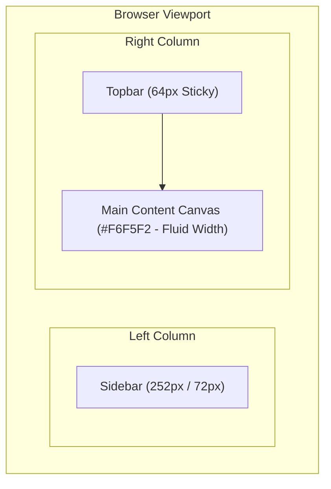

# Đặc Tả Kiến Trúc App Shell (App Shell Specification)

> **TrendMotion Studio — App Shell & Navigation Framework**  
> Khung ứng dụng đóng vai trò bộ xương nền tảng (Master Layout) đảm bảo tính ổn định, dễ điều hướng và khả năng mở rộng cao cho tất cả các phân hệ nghiệp vụ.

---

## 1. Cấu Trúc Bố Cục Tổng Thể (Master Architecture)

App Shell bao gồm 3 phân vùng chính:
1. **Sidebar (Thanh điều hướng bên trái):** Điều hướng chính cấp ứng dụng, phân nhóm theo không gian làm việc.
2. **Topbar (Thanh tiêu đề phía trên):** Hiển thị breadcrumb định vị trang, chỉ số hạn mức credit và menu tài khoản.
3. **Main Content (Vùng làm việc chính):** Không gian mở rộng chứa toàn bộ nội dung của trang hiện tại trên nền canvas `#F6F5F2`.

---

## 2. Đặc Tả Chi Tiết Sidebar

### 2.1. Kích thước & Trạng thái hoạt động
- **Chiều rộng mặc định (Expanded):** `252px`.
- **Chiều rộng thu gọn (Collapsed):** `72px`.
- **Độ cao:** `100vh` (chiều cao toàn màn hình, sticky bên trái).
- **Màu nền:** Bề mặt trắng `#FFFFFF`, đường phân cách bên phải `1px solid #E8E5E0`.
- **Hiệu ứng chuyển đổi (Transition):** `200ms cubic-bezier(0.4, 0, 0.2, 1)`. Vùng nội dung Main Content tự động co giãn đồng bộ, không tạo độ giật layout.
- **Lưu trữ trạng thái:** Trạng thái mở rộng/thu gọn được lưu trong `localStorage` với khóa `trendmotion_sidebar_collapsed` và phục hồi chính xác khi tải lại trang.

### 2.2. Phần Thương hiệu (Brand Wordmark)
- **Vị trí:** Đầu Sidebar, chiều cao `76px`, padding ngang `20px`, viền đáy `1px solid #E8E5E0`.
- **Dòng 1:** Wordmark chính `trendmotion`, font Be Vietnam Pro cỡ `19px`, trọng số `700 (Bold)`, màu `#242321`, tracking nhẹ. (Khi thu gọn hiển thị chữ viết tắt `tm`).
- **Dòng 2:** Nhãn phụ `studio`, cỡ `10px`, trọng số `600 (SemiBold)`, màu `#74716D`, letter-spacing `0.5px`, viết hoa toàn bộ. (Ẩn khi thu gọn).
- **Nguyên tắc:** Căn thẳng cùng một trục lề trái, tuyệt đối không dùng icon robot, hình AI hay logo minh họa không cần thiết.

### 2.3. Bốn Nhóm Điều Hướng & Tám Menu Chính

Thanh điều hướng phân tách thành 4 nhóm nghiệp vụ rõ ràng:

| Nhóm | Tên Menu | Đường dẫn (Route) | Icon Lucide (18px) | Vai trò nghiệp vụ |
| :--- | :--- | :--- | :--- | :--- |
| **KHÔNG GIAN** | **Tổng quan** | `/overview` | `LayoutDashboard` | Bàn làm việc tổng hợp, theo dõi chỉ số chung |
| **NGHIÊN CỨU** | **Nghiên cứu sản phẩm** | `/products` | `Search` | Tìm kiếm sản phẩm thời trang & phân tích ad |
| | **Phân tích kênh** | `/channels` | `Users` | Đánh giá kênh sáng tạo TikTok & chỉ số tương tác |
| **SÁNG TẠO** | **Studio tạo video** | `/studio` | `Clapperboard` | Phối người mẫu AI & sản xuất video 9:16 |
| | **Người mẫu** | `/models` | `UserRound` | Quản lý kho người mẫu thời trang ảo |
| | **Thư viện** | `/library` | `Library` | Quản lý ảnh gốc, biến thể và video thành phẩm |
| **TÀI KHOẢN** | **Ví credit** | `/wallet` | `Wallet` | Lịch sử biến động credit & nạp hạn mức |
| | **Cài đặt** | `/settings` | `Settings` | Cấu hình tài khoản và tùy chọn ứng dụng |

### 2.4. Trạng thái Menu Item
- **Kích thước:** Chiều cao `42px`, padding ngang `12px`, bo góc `8px`, khoảng cách icon tới chữ `11px`.
- **Mặc định:** Chữ và icon mang màu `#5C5955`.
- **Hover:** Nền chuyển `#F7F6F4`, chữ và icon chuyển `#242321`.
- **Active (Đang chọn):**
  - Suy ra trực tiếp từ URL hiện tại (`useLocation().pathname`).
  - Nền chuyển `#F2EDF5`, chữ và icon chuyển sang sắc tím trầm `#654B7B` (font-weight 600).
  - Có vạch chỉ dẫn mảnh `2px` ở mép trái menu (`bg-[#654B7B] rounded-r`).
- **Khi thu gọn (Collapsed Mode):**
  - Tên nhóm và nhãn chữ được ẩn; icon căn giữa chính xác `72px`.
  - Hiển thị Tooltip nền `#292725` ở bên phải sau 300ms hover, không bị che khuất bởi Sidebar.

### 2.5. Nút Toggle Thu Gọn / Mở Rộng
- Đặt tại chân Sidebar, phân cách bằng viền trên `1px solid #E8E5E0`.
- Khi Sidebar mở: Icon `PanelLeftClose`, nhãn `Thu gọn thanh bên`, `aria-label="Thu gọn thanh bên"`.
- Khi Sidebar thu gọn: Icon `PanelLeftOpen`, Tooltip `Mở rộng thanh bên`, `aria-label="Mở rộng thanh bên"`.

---

## 3. Đặc Tả Chi Tiết Topbar

- **Kích thước & Vị trí:** Chiều cao cố định `64px`, dính cố định (`sticky top-0 z-20`), nền trắng `#FFFFFF`, viền đáy `1px solid #E8E5E0`. Bắt đầu ngay sau mép phải Sidebar.
- **Khu vực bên trái:**
  - *Nút mở Mobile Drawer:* Icon `Menu` 18px (chỉ hiển thị trên màn hình nhỏ `<1024px`, vùng bấm tối thiểu 40x40px).
  - *Breadcrumb định vị:* Hiển thị chính xác tên trang theo route hiện tại (ví dụ: `Tổng quan`, `Nghiên cứu sản phẩm`, `Studio tạo video`).
- **Khu vực bên phải:**
  - *Chỉ báo Credit (Credit Indicator):*
    - Hộp bo góc nền `#FBFAF8` có viền `#E8E5E0`.
    - Icon `Wallet` 16px màu tím `#654B7B`, nhãn `Credit`.
    - Giá trị hiển thị bắt buộc: `—` (gạch ngang do chưa có Backend, không dùng số giả).
    - Nút `Nạp credit` (cao 34px, nền trắng, viền `#E8E5E0`, chữ `#242321`, khi click điều hướng về `/wallet`).
  - *Avatar Tài Khoản:*
    - Nút tròn `36x36px` nền xám nhạt `#EFEEEB` với ký tự `U` ở giữa.
    - Click mở Dropdown Menu: hiển thị mục `Tài khoản` và `Cài đặt` (đều dẫn đến `/settings`).
    - Tự động đóng khi click ra ngoài hoặc nhấn phím Escape. Không có nút đăng xuất giả.

---

## 4. Đặc Tả Vùng Main Content & Cuộn Trang

- **Nền:** `#F6F5F2` (Canvas chuẩn).
- **Padding:** Desktop `32px`, màn hình vừa `28px`, mobile `16px`.
- **Chiều rộng:** Thích ứng linh hoạt (`max-w-7xl w-full mx-auto`).
- **Nguyên tắc Cuộn trang đơn nhất (Single Scrollbar Rule):**
  - Tuyệt đối không tạo thanh cuộn dọc lồng nhau (không đặt `height: calc(100vh - 64px)` kèm `overflow-y: auto` trên Main Content trong khi Body cũng cuộn).
  - Toàn bộ trang được cuộn tự nhiên bằng thanh cuộn của trình duyệt (`window`).
  - Chuột không bao giờ bị kẹt khi cuộn ở giữa màn hình.

---

## 5. Hành Vi Thích Ứng Đa Thiết Bị (Responsive Matrix)

| Kích thước Viewport | Cấu hình Sidebar | Topbar & Breadcrumb | Main Content |
| :--- | :--- | :--- | :--- |
| **Desktop Lớn (1440x900)** | Mở rộng 252px (hoặc thu gọn 72px tùy người dùng lưu trữ) | Hiển thị đầy đủ Breadcrumb, Credit box, Avatar | Padding 32px, chiều rộng fluid tối đa 1280px |
| **Desktop Tiêu chuẩn (1366x768)**| Mở rộng 252px, chuyển đổi 72px mượt mà | Đầy đủ Breadcrumb, Credit box, Avatar | Padding 32px, hiển thị thoáng đãng |
| **Màn hình Vừa / Tablet Ngang (1024x768)**| Hỗ trợ thu gọn 72px để giải phóng không gian | Đầy đủ Breadcrumb và công cụ bên phải | Padding 28px, bảng tự cuộn ngang nội bộ nếu dài |
| **Tablet Dọc (768x1024)** | Chuyển thành Mobile Drawer có nút mở Hamburger | Hamburger + Breadcrumb + Credit + Avatar | Padding 20px, nội dung chuyển 1-2 cột |
| **Mobile (390x844)** | Drawer ẩn hoàn toàn; trượt ra từ mép trái khi bấm | Hamburger + Tên trang rút gọn + Avatar | Padding 16px, nút bấm tối thiểu 40px |

---

## 6. Kiểm Soát Trạng Thái Trang Nghiệp Vụ

Tất cả các route nghiệp vụ (`/products`, `/channels`, `/studio`, `/models`, `/library`, `/wallet`, `/settings`, `/overview`) ở giai đoạn này đều hiển thị thông qua `PageContainer` kết hợp component `EmptyState` chuẩn:
- **Tiêu đề:** `Chức năng đang được phát triển`
- **Mô tả:** `Nội dung của khu vực này sẽ được hoàn thiện trong giai đoạn tiếp theo.`
- **Trang 404 (`*`):** `Không tìm thấy trang`, mô tả giải thích và nút `Quay về tổng quan`.
