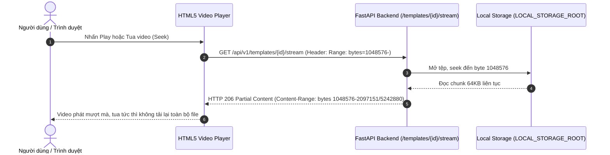

# Tài Liệu Tham Khảo Thiết Kế & Kỹ Thuật: Video Template Library

Tài liệu này ghi nhận kết quả nghiên cứu các sản phẩm tham khảo (CapCut Templates, Canva Video Templates) và cơ sở kỹ thuật phát media cục bộ (FFmpeg/FFprobe, HTML5 Video, HTTP Range Requests RFC 7233) để xây dựng module Thư viện Video Mẫu cho TrendMotion Studio.

---

## 1. Nghiên Cứu Sản Phẩm Tham Khảo

### 1.1. CapCut Templates (`capcut.com/templates`)
- **Cách thức tổ chức danh mục:**
  - Danh mục được nhóm theo mục đích nội dung (Lookbook, Trend, Beat, Daily, Cinematic).
  - Thẻ video ưu tiên tỷ lệ dọc 9:16 (chuẩn TikTok/Reels) nhưng linh hoạt mở rộng cho các tỷ lệ khác (16:9, 1:1) mà không ép méo khung hình.
- **Trải nghiệm duyệt và xem trước (Preview):**
  - Ảnh poster tĩnh đại diện là frame thực tế trích xuất từ video, không sử dụng ảnh minh họa stock.
  - Trên desktop, khi di chuột vào thẻ (hover), video phát preview ở chế độ im lặng (muted) sau một độ trễ ngắn (~250-300ms) để tránh giật lag khi lướt chuột qua lại. Chỉ đúng một thẻ được phát tại một thời điểm.
  - Khi rời chuột, video dừng và khôi phục lại poster gốc. Không tự động phát âm thanh ngoài ý muốn của người dùng.
- **Trình bày thông tin trên thẻ:**
  - Tên mẫu hiển thị tối đa 2 dòng, rõ ràng, không kèm các huy hiệu lòe loẹt gây nhiễu thị giác.
  - Thời lượng video (Duration) được ghim ở góc hoặc hiển thị kèm các thông số kỹ thuật ngắn gọn.
  - Nút lưu yêu thích (Bookmark/Favorite) nằm độc lập ở góc trên, click không gây mở nhầm trang chi tiết.

### 1.2. Canva Video Templates (`canva.com/video-editor/templates/`)
- **Trình bày chi tiết mẫu:**
  - Trang chi tiết phân tách rõ ràng: Bên trái là trình phát video trung tâm; bên phải là toàn bộ thông số kỹ thuật, tỷ lệ khung hình, định dạng và các thuộc tính tương thích.
  - Cung cấp mô tả chi tiết về cấu trúc cảnh và nhịp điệu của video để người dùng nắm bắt trước khi sử dụng.
- **Tính độc lập của mẫu:**
  - Video mẫu là tài nguyên mẫu gốc, không bị biến đổi bởi hành động xem hoặc lưu trữ của người dùng.

---

## 2. Kỹ Thuật Đọc Metadata & Xử Lý Media Local (FFmpeg / FFprobe)

Hệ thống TrendMotion Studio vận hành hoàn toàn trên **Local Filesystem Storage** (`LOCAL_STORAGE_ROOT`). Để chuẩn bị và lập chỉ mục catalog video mẫu, các công cụ dòng lệnh chạy trực tiếp trên máy chủ backend:

### 2.1. Đọc thông số kỹ thuật bằng FFprobe
Lệnh trích xuất JSON toàn diện không cần load video vào bộ nhớ:
```bash
ffprobe -v error -select_streams v:0 -show_entries stream=width,height,r_frame_rate,codec_name,duration -show_entries format=duration,size,bit_rate -of json input.mp4
```
- **Thông số thu được:**
  - `durationMs`: Thời lượng chính xác từng mili-giây.
  - `width` & `height`: Độ phân giải gốc.
  - `aspectRatio`: Tính toán từ width/height (9:16, 16:9, 1:1).
  - `frameRate`: Tốc độ khung hình (fps).
  - `videoCodec`: Chuẩn nén (h264, hevc).

### 2.2. Trích xuất Poster Frame bằng FFmpeg
Trích xuất một khung hình đại diện tại thời điểm thích hợp (ví dụ giây thứ 1.0) để làm poster tĩnh:
```bash
ffmpeg -ss 00:00:01.000 -i input.mp4 -vframes 1 -q:v 2 poster.jpg
```

### 2.3. Tạo Video Xem Trước (Preview Video)
Tối ưu hóa file xem trước dung lượng nhẹ, tắt âm thanh để phục vụ hover preview trên web:
```bash
ffmpeg -i input.mp4 -vf "scale=540:-2" -c:v libx264 -crf 28 -an preview.mp4
```

---

## 3. Cơ Chế Phát Video Local Qua Backend & HTTP Range Requests (RFC 7233)

Frontend không truy cập trực tiếp ổ đĩa và không dùng đường dẫn tệp máy chủ. Backend đóng vai trò cung cấp luồng phát video có xác thực:



- **Hỗ trợ HTTP Range:** Trả về mã phản hồi `206 Partial Content`, header `Accept-Ranges: bytes`, `Content-Range`, `Content-Length`.
- **Tránh tràn RAM:** Sử dụng Python chunked generator (đọc từng khối 64KB) thay vì đọc toàn bộ file video lớn vào RAM.
- **Xử lý mã 416:** Khi client yêu cầu phạm vi byte vượt quá dung lượng tệp (`Range Not Satisfiable`), backend phản hồi mã 416 kèm header `Content-Range: bytes */{total_size}`.

---

## 4. Bảng Phân Biệt Thực Tế vs. Thông Tin Chưa Xác Minh

| Hạng mục thuộc tính | Thực tế quan sát & Xác minh được | Thông tin giả định / Chưa xác minh (Cấm tự bịa) |
| :--- | :--- | :--- |
| **Thông số Video** | Width, height, duration, fps, codec đọc được từ FFprobe | Tự ghi thời lượng hoặc tỷ lệ khung hình ngẫu nhiên khi chưa phân tích file |
| **Poster Thumbnail** | Frame ảnh chụp thật từ video gốc | Ảnh stock người mẫu khác, ảnh AI sinh tự do không khớp video |
| **Cấu trúc cảnh (Scenes)** | Phân tích mốc thời gian thực tế, góc quay, hành động diễn ra | Tự chia đều video thành các đoạn 5s/10s ngẫu nhiên rồi đặt tên là scene |
| **Vùng trang phục (Garment Slots)** | Vùng cơ thể nhìn thấy rõ trong video (áo thân trên, váy toàn thân) | Tuyên bố template "thay được mọi trang phục" dù video chỉ quay nửa người |
| **Lượt sử dụng (Usage Count)** | Đếm từ số lượng generation thực tế trong database | Tự gán các con số như "10,000+ uses" hoặc huy hiệu "VIRAL", "HOT" |
| **Độ tương thích (Compatibility)** | Các tiêu chí kỹ thuật: tỷ lệ khung hình, khoảng cách khung hình, góc mặt | Điểm số tương thích giả như "99% AI Ready" |
